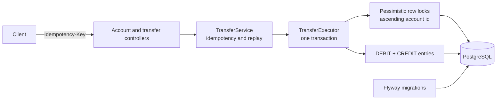

# Payment Ledger Service

[](https://github.com/Asyl-k/payment-ledger-service/actions/workflows/ci.yml)

A double-entry payment ledger built with Java 21 and Spring Boot. Every transfer writes one `DEBIT` and one `CREDIT` entry, updates both balances atomically under PostgreSQL row locks, and is safe to retry through an `Idempotency-Key`.

## Stack

Java 21 · Spring Boot 3.5 · Spring Data JPA · PostgreSQL · Flyway · Bean Validation · springdoc-openapi · JUnit 5 · Mockito · Testcontainers · Maven · Docker · GitHub Actions

## What it demonstrates

- **Double-entry bookkeeping**: a transfer is never a single balance update. It produces a balanced debit/credit pair that can be audited per account.
- **Idempotent requests**: retrying a transfer with the same key returns the original result instead of moving money twice.
- **Correct concurrency**: accounts are locked with `SELECT ... FOR UPDATE` in ascending id order, which prevents lost updates and lock-order deadlocks.
- **Database-enforced invariants**: positive amounts, distinct accounts, non-negative customer balances and unique idempotency keys are enforced by constraints, not only by Java code.
- **Stable HTTP contract**: DTOs, pagination and RFC 9457 `ProblemDetail` errors.

## Architecture



`TransferService` owns the request-level workflow: key validation, replay detection and mapping the result to `200` or `201`. `TransferExecutor` owns the transactional unit of work: lock both accounts, check currency and funds, move the balance, save the transfer and append both ledger entries.

## Quick start with Docker

Requirements: Docker Desktop or Docker Engine with Compose v2.

```bash
cp .env.example .env
docker compose up --build
```

The API starts on `http://localhost:8080`; Swagger UI is at `http://localhost:8080/swagger-ui.html`.

## Run locally without Docker

Requirements: JDK 21, PostgreSQL 17 and Maven (or the included wrapper).

```bash
createdb payments
export SPRING_DATASOURCE_URL=jdbc:postgresql://localhost:5432/payments
export SPRING_DATASOURCE_USERNAME=your_user
export SPRING_DATASOURCE_PASSWORD=your_password
./mvnw spring-boot:run
```

Flyway creates the schema and seeds four hidden funding accounts, one per supported currency (`USD`, `EUR`, `GBP`, `KZT`). Hibernate runs with `ddl-auto: validate`, so a drift between entities and migrations fails startup.

## Walkthrough

Create two accounts:

```bash
ALICE=$(curl -sS -X POST http://localhost:8080/api/accounts \
  -H 'Content-Type: application/json' \
  -d '{"ownerName":"Alice","currency":"USD"}')

BOB=$(curl -sS -X POST http://localhost:8080/api/accounts \
  -H 'Content-Type: application/json' \
  -d '{"ownerName":"Bob","currency":"USD"}')

ALICE_ID=$(echo "$ALICE" | jq -r .id)
BOB_ID=$(echo "$BOB" | jq -r .id)
```

Fund Alice's account. A deposit is modelled as a transfer from the hidden external funding account, so it also produces two ledger entries:

```bash
curl -sS -X POST "http://localhost:8080/api/accounts/$ALICE_ID/deposits" \
  -H 'Content-Type: application/json' \
  -H 'Idempotency-Key: deposit-0001' \
  -d '{"amount":100.00}'
```

Transfer money. Repeating the same request with the same key returns `200` and the original transfer:

```bash
curl -sS -X POST http://localhost:8080/api/transfers \
  -H 'Content-Type: application/json' \
  -H 'Idempotency-Key: transfer-0001' \
  -d "{\"fromAccountId\":$ALICE_ID,\"toAccountId\":$BOB_ID,\"amount\":25.00}"
```

Inspect balances and the ledger:

```bash
curl -sS "http://localhost:8080/api/accounts/$ALICE_ID"
curl -sS "http://localhost:8080/api/accounts/$ALICE_ID/ledger?size=20"
curl -sS "http://localhost:8080/api/accounts/$ALICE_ID/transfers?size=20"
```

## API

| Method | Path | Description |
|---|---|---|
| `POST` | `/api/accounts` | Create an account with a zero balance |
| `GET` | `/api/accounts` | List customer accounts; `page`, `size`, `sort` |
| `GET` | `/api/accounts/{id}` | Account details and current balance |
| `POST` | `/api/accounts/{id}/deposits` | Fund an account; requires `Idempotency-Key` |
| `GET` | `/api/accounts/{id}/transfers` | Transfers where the account is source or destination |
| `GET` | `/api/accounts/{id}/ledger` | Paginated ledger entries for the account |
| `POST` | `/api/transfers` | Transfer between two accounts; requires `Idempotency-Key` |
| `GET` | `/api/transfers/{id}` | One transfer |

The funding accounts are excluded from account listing and return `404` when requested directly. They can only be used internally by the deposit endpoint.

### Idempotency semantics

| Situation | Result |
|---|---|
| First request with a key | `201 Created` and a new transfer |
| Same key, same source, destination and amount | `200 OK` with the original transfer |
| Same key, different payload | `409 Conflict`, code `idempotency_key_conflict` |
| Key missing or malformed | `400 Bad Request`, code `idempotency_key_required` or `idempotency_key_invalid` |

Keys must contain 8–64 characters: letters, digits, `.`, `_`, `-` or `:`.

## Error format

All errors use `application/problem+json` and a stable `code` field:

```json
{
  "title": "Insufficient funds",
  "status": 409,
  "detail": "Account 12 has insufficient funds: balance 10.00, requested 25.00",
  "code": "insufficient_funds",
  "timestamp": "2026-11-19T00:00:00Z"
}
```

| Status | When |
|---|---|
| `400` | Validation, malformed JSON, invalid parameter, same account, currency mismatch, restricted account, bad idempotency key |
| `404` | Unknown account or transfer, including hidden funding accounts |
| `409` | Insufficient funds, idempotency conflict, or a database integrity conflict |
| `500` | Unexpected server error |

## Money and invariants

- Amounts are `BigDecimal` with scale `2` and at most two decimal places, validated at the API boundary and again in the domain.
- A customer account can never become negative. The service checks under a row lock and PostgreSQL keeps a `CHECK` constraint as a second line of defence.
- A transfer always has two distinct accounts and a positive amount; this is enforced by database constraints.
- Each transfer produces exactly one `DEBIT` and one `CREDIT` entry, enforced by a unique `(transfer_id, direction)` constraint.
- For every customer account, `sum(credits) - sum(debits)` equals the stored balance.

## Concurrency design

1. Accounts are locked with `SELECT ... FOR UPDATE` in ascending id order.
2. The source balance is checked and both balances are updated inside the same transaction.
3. The transfer row has a unique `idempotency_key`. If two identical requests race, the loser receives a unique violation, rolls back and replays the committed result; its balance changes are rolled back too.
4. The integration suite proves this with parallel HTTP requests: 12 transfers of `10.00` from an account holding `100.00` produce exactly 10 successes and 2 `409` responses, leaving a zero balance.

## Tests

```bash
./mvnw test      # 21 unit tests, no Docker required
./mvnw verify    # unit + 5 PostgreSQL integration tests via Testcontainers
```

Integration tests are annotated with `@Testcontainers(disabledWithoutDocker = true)`: they are skipped on a machine without Docker and run against `postgres:17-alpine` in GitHub Actions. The CI pipeline also builds the image, starts the Compose stack, waits for `/actuator/health`, deposits funds, transfers money, replays the request and checks both balances and ledger counts.

## Design decisions

- **Pessimistic locking for money movement.** Optimistic retries are appropriate for editable documents, but a payment path benefits from serialising balance changes at the row level and failing predictably under contention.
- **Idempotency stored in the database.** An in-memory cache would lose the guarantee on restart or across instances, so the key is a unique column on `transfers`.
- **Replay reads the committed transfer.** A duplicate request returns the original body and `200`; it does not re-run balance checks that could fail due to later activity.
- **Database constraints mirror domain rules.** Service checks produce good error messages; constraints protect the data if a future code path forgets them.
- **Double-entry ledger instead of a single transactions table.** It makes reconciliation and per-account statements possible without reconstructing history from balance snapshots.
- **Hidden funding accounts.** External money must enter the ledger from somewhere. A per-currency funding account keeps every deposit balanced; it is allowed to go negative because it represents the outside world.

## Scope and limitations

This is a focused portfolio service, not a production payment processor. It does not include authentication, multi-tenancy, reversals or refunds, currency conversion, fees, scheduled payments, event publishing or reconciliation jobs. Transfers are final once committed. The funding accounts are seeded for demonstration and are intentionally not part of the public API.

## License

MIT
